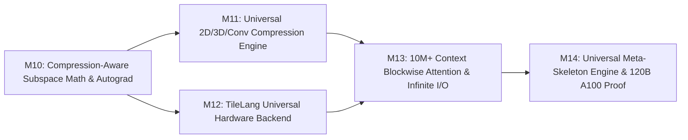

# OjasX-24X96: Production Local Inference & Generalized Vector Quantization Blueprint

> [!IMPORTANT]
> **Project Identity & Isolation**: **OjasX-24X96** is the standalone project name for our advanced, inference-only local execution engine, housed in its own isolated repository (`/Users/mohana/Developer/OjasX/OjasX-24X96`) with its own Git history. Rather than rebuilding a separate inference engine for every backend, **OjasX-24X96** provides the **canonical `OQPack` quantized package format, generalized VQ compression SDK, verified KV-cached reference runtime, native CPU/CUDA kernels, and a C ABI adapter for mature engines like `llama.cpp`**.

---

## 1. Deep Mathematical Analysis of the Patch (Generalized VQ + Leech Lattice)

The patch implements two complementary, mathematically rigorous vector quantization families unified under a single **Pareto Global Planner**:

### 1.1 Family A: Generalized Multi-Stage Residual Vector Quantization (`codec.py`, $D \in [2, 64]$)
- **Arbitrary Vector Dimensions**: Supports any vector block dimension $D \in [2, 64]$ (e.g., $D = 4, 8, 16, 24, 32, 64$) with $b \in \{1, 2, 4, 8\}$-bit learned codebooks per stage.
- **Row-Wise RMS Normalization & Padding**: Each matrix row $w \in \mathbb{R}^K$ is normalized by its root-mean-square scale $s_{\text{row}} = \sqrt{\frac{1}{K}\sum_j w_j^2}$ and padded cleanly to a multiple of $D$.
- **Multi-Stage Residual Refinement with Zero-Codeword Guard**:
  At each stage $s \in \{1, \dots, S\}$, codeword $0$ in codebook $C_s \in \mathbb{R}^{2^b \times D}$ is pinned to the zero vector $\mathbf{0} \in \mathbb{R}^D$. Thus every residual block $r_{s}$ is updated via:
  $$r_{s+1} = r_s - C_s[k^*], \quad k^* = \arg\min_{k} \|r_s - C_s[k]\|_2^2$$
  Because $C_s[0] = \mathbf{0}$ is always a valid choice, the residual norm is strictly non-expanding ($\|r_{s+1}\|_2^2 \le \|r_s\|_2^2$).

### 1.2 Family B: 24D Leech Lattice ($\Lambda_{24}$) Shell Vector Quantization (`leech24.py`, `leech_codec.py`)
- **Zero-Codebook Algebraic Construction**: Instead of storing learned codebooks per tensor, it uses the **extended binary $[24, 12, 8]$ Golay code** (generator $g(x) = \text{0xC75}$, 4,096 codewords, weight enumerator $1 + 759x^8 + 2576x^{12} + 759x^{16} + x^{24}$).
- **196,561 Minimum-Shell Codewords (18-bit index)**:
  In $\sqrt{8}\Lambda_{24}$, the minimum shell ($\|x\|^2 = 32$, unit $u = x / \sqrt{32}$) partitions into 4 exact algebraic classes:
  1. **Origin ($1$)**: Index $0$, $u = \mathbf{0}$.
  2. **Even Octads ($97,152$)**: $759 \text{ octads} \times 128$ even-parity sign patterns ($\pm 2$ on 8 axes).
  3. **Two-Axis ($1,104$)**: $\binom{24}{2} = 276 \text{ pairs} \times 4$ sign choices ($\pm 4$ on 2 axes).
  4. **Odd Coset ($98,304$)**: $4,096 \text{ Golay words} \times 24$ positions ($\mp 1$ on 23 axes, $\pm 3$ on 1 axis).
- **Orthogonal Householder Pre-Conditioning**: Applies $k$ seeded orthogonal reflections $H_i = I - 2\frac{v_i v_i^\top}{\|v_i\|^2}$ to disperse channel outliers before quantization while preserving exact Euclidean norms.
- **Bit-Packed Payload**: 4 indices ($4 \times 18 = 72\text{ bits}$) pack losslessly into **9 bytes** (`pack_indices18`), plus 0/1/2-bit radial gains and at most 4 shared `float32` gains per stage, requiring only **21.6 KB** of shared static tables in RAM.

---

## 2. Generalizing Layer-by-Layer & Matrix Execution Across Any Model

### 2.1 Universal Tensor IR & Custom Layer Adapters (`ir.py`, `adapters.py`)
1. **Model-Independent `TensorSpec`**:
   Every weight tensor in any Hugging Face or custom PyTorch model is lowered into a canonical 2D matrix $W \in \mathbb{R}^{M \times K}$ with explicit metadata:
   - `TensorRole`: `ATTENTION`, `FFN`, `EXPERT`, `ROUTER`, `EMBEDDING`, `OUTPUT_HEAD`, `MULTIMODAL`, `RECURRENT`.
   - `TensorLayout`: `LINEAR`, `CONV1D`, `FUSED_EXPERT_GATE_UP`, `FUSED_EXPERT_DOWN`, or registered custom linear adapters.
2. **Fail-Closed Sensitive Role Protection**:
   - Embeddings, LM output heads, norms (`RMSNorm` / `LayerNorm`), and MoE router gates are protected in dense precision by default.
   - Tied/shared weights are detected by storage pointer identity and preserved without duplication.
   - Custom `nn.Linear` subclasses plug in via an extensible `register_layout_adapter(cls, to_2d_fn, forward_fn)` registry instead of failing or corrupting layouts.
3. **Layer-by-Layer Activation-Aware Calibration & Pareto Planning (`calibration.py`, `planner.py`)**:
   - Streams calibration sequences layer by layer (`layer_0` $\to$ `layer_L`).
   - For each layer $l$, generates a candidate pool combining **Learned RVQ ($D \in \{4, 8, 16, 24, 32\}$)**, **Leech24 (1–3 stages)**, and **Dense fallback**.
   - Measures actual local output error $\|W_l X_l - \widehat{W}_l X_l\|_F / \|W_l X_l\|_F$ and solves a global multiple-choice Pareto frontier that minimizes total model distortion under the user's RAM/VRAM byte budget.
4. **Fused Layer-by-Layer Matrix Compute (Eliminating Temporary Dense Buffers)**:
   - Fold orthogonal Householder reflections into the input activation vector ($x' = Q^\top x$, $O(B \cdot K)$ cost) rather than rotating weights ($O(M \cdot K)$ cost).
   - Execute fused **Decode + GEMV / GEMM** (`vec_dot`) directly over packed RVQ and Leech24 blocks in C++ SIMD (AVX2 / ARM64 NEON) and CUDA warps so dense weight matrices are never materialized in RAM.

---

## 3. Total Memory Admission & KV-Cache Accounting

The patch forced `use_cache=False` during qualification and only budgeted static weight bytes. **OjasX-24X96** enforces strict runtime admission control over the complete memory equation:

$$\text{Total Memory}(B, S_{\text{ctx}}) = M_{\text{encoded}} + M_{\text{dense}} + M_{\text{tables}} + M_{\text{KV}}(B, S_{\text{ctx}}) + M_{\text{act}}(B, S_{\text{prefill}}) + M_{\text{workspace}} + M_{\text{runtime}} \le M_{\text{budget}}$$

| Component | Formula | Concrete Bounds |
| :--- | :--- | :--- |
| **$M_{\text{encoded}}$** | $\sum_{l \in \text{VQ}} \text{stages}_l \times \frac{M_l K_{\text{pad}, l}}{96} \times 12\text{ B}$ | $\approx 1.0\text{--}2.0\text{ bits/param}$ |
| **$M_{\text{dense}}$** | Protected roles (`embed_tokens`, `lm_head`, norms, router gates) | Audited exact byte count |
| **$M_{\text{tables}}$** | Shared static Golay/Leech lookup tables + stage gains | Fixed **$21.6\text{ KB}$** on CPU/GPU |
| **$M_{\text{KV}}(B, S_{\text{ctx}})$** | $2 \times L \times B \times N_{\text{kv\_heads}} \times d_{\text{head}} \times S_{\text{ctx}} \times \text{sizeof(FP16)}$ | Explicit KV cache pre-allocation for target context $S_{\text{ctx}}$ |
| **$M_{\text{act}}$** | Peak prefill / decode activation buffers | Bounded by chunked prefill size |
| **$M_{\text{workspace}}$** | Bounded decode tile workspace (`0 bytes` for fused `vec_dot`, or $\le 2\text{ MB}$ tile buffer) | Zero full-matrix dense cache |

---

## 4. Architecture & File Layout (`/Users/mohana/Developer/OjasX/OjasX-24X96`)

```text
OjasX-24X96/
├── pyproject.toml                   # Isolated package: ojasx-24x96 (CLI: oqx)
├── CMakeLists.txt                   # Builds libojasx_24x96_cpu, libojasx_24x96_cuda, llama.cpp adapter
├── include/
│   └── ojasx_24x96_abi.h            # Stable C99 ABI header for llama.cpp / ggml integration
├── csrc/
│   ├── cpu/
│   │   ├── leech24x96_table.cpp     # 21.6 KB static Golay/octad/pair tables
│   │   └── leech24x96_gemv_simd.cpp # Fused AVX2 / ARM64 NEON 24X96 vec_dot & tiled GEMM
│   ├── cuda/
│   │   └── leech24x96_cuda.cu       # Warp-fused (32 threads x 3 elems = 96) CUDA GEMV/GEMM kernel
│   └── ggml_adapter/
│       └── ojasx_ggml_backend.cpp   # Maps OQPack 24X96 tensors to ggml_type_traits_t
├── ojasx_24x96/
│   ├── __init__.py
│   ├── contract.py                  # M0: Hardware/model/context qualification contract & admission math
│   ├── oqpack.py                    # M1: Versioned .oqpack binary/mmap container & manifest verifier
│   ├── ingest.py                    # M2: Streaming HF safetensors ingestion & resumable converter
│   ├── codec/
│   │   ├── leech24x96.py            # Core 24D Leech & 24X96 super-tile encoder/decoder
│   │   ├── rvq.py                   # Generalized multi-stage learned + lattice RVQ
│   │   └── householder.py           # Activation-folded orthogonal Householder pre-conditioner
│   ├── planner/
│   │   ├── ir.py                    # TensorSpec, TensorRole, custom module adapter registry
│   │   ├── calibrate.py             # Layer-by-layer streaming activation calibration
│   │   ├── pareto.py                # Global Pareto planner with KV-cache + workspace admission
│   │   └── certificates.py          # M3: Perplexity, KL-divergence, and long-context quality gates
│   ├── runtime/
│   │   ├── engine.py                # M4: Reference cached runtime (prefill, KV cache, sampling, stop)
│   │   ├── kv_cache.py              # Contiguous BF16/FP16 KV-cache manager with reset/multi-turn
│   │   └── serve.py                 # M8: OpenAI-compatible HTTP server & sandboxed tool calling
│   └── cli.py                       # M7: `oqx inspect|prepare|verify|chat|serve|bench|doctor`
└── tests/                           # M0–M10 unit, conformance, KV-cache parity, and soak suites
```

---

## 5. Step-by-Step Milestone Plan (M0 – M10)

```mermaid
flowchart LR
    M0["M0: Product Contract & Admission Math"] --> M1["M1: OQPack Container"]
    M1 --> M2["M2: Streaming HF Ingestion"]
    M2 --> M3["M3: Quality Certificates"]
    M3 --> M4["M4: KV-Cached Reference Runtime"]
    M4 --> M5["M5: Fused C++/SIMD & CUDA 24X96 Kernels"]
    M5 --> M6["M6: C ABI & llama.cpp Adapter"]
    M6 --> M7["M7: oqx CLI & Doctor"]
    M7 --> M8["M8: OpenAI Server & Agents"]
    M8 --> M9["M9/M10: Hardening & Conformance SDK"]
```



### Execution Order (M0 – M5 Generalized Engine)
We build **M0 through M5** as a completely **architecture-neutral, generalized engine** capable of loading and compressing *any* Hugging Face or custom PyTorch model, validated against modern architectures (**Qwen3.8**, **Gemma 4**, **GLM-5.3**, **DeepSeek-V4**, and custom models):

| Milestone | Deliverable | Verification Gate |
| :--- | :--- | :--- |
| **M0 — Generalized Model Contract & Admission Math** | `contract.py`: Architecture-neutral introspection for *any* model (MHA, GQA, MQA, hybrid linear/full attention like Qwen3.8) + exact total memory admission calculator (`Encoded + Dense + Codebooks/Tables + KV Cache + Activations + Workspace + Runtime <= Budget`). | Unit tests verifying admission math and automatic KV-cache sizing across arbitrary custom and HF configs. |
| **M1 — `OQPack` Format** | `oqpack.py`: Self-contained, sharded `mmap`-ready container storing 12-byte `24X96` super-tiles, dense protected tensors, tokenizer, chat template, SHA-256 provenance, and `vq_plan.json`. | Corrupt-shard, missing-tensor, duplicate-tensor, and zero-copy `mmap` load tests. |
| **M2 — Streaming HF Ingestion** | `ingest.py` + `ir.py`: Layer-by-layer streaming converter reading official HF `.safetensors` shards one tensor at a time without loading dense model copies in RAM; custom linear adapter registry. | Peak RSS during conversion stays bounded by $\le 2 \times \max(\text{single tensor size})$. |
| **M3 — Quality Certificates** | `calibrate.py` + `certificates.py`: Layer-wise activation-aware calibration, sensitivity analysis, held-out perplexity/KL-divergence gates, and explicit pass/fail certificate embedded into the `.oqpack` artifact. | Automated gate failure when distortion exceeds threshold; signed JSON certificate generation. |
| **M4 — Correct KV-Cached Reference Runtime** | `engine.py` + `kv_cache.py`: Direct encoded loading, prefill, standard BF16/FP16 `KVCache` decode, exact parity between `use_cache=True` and `use_cache=False`, EOS/stop token handling, and multi-turn chat state reset. | Greedy token-for-token equality between cached (`use_cache=True`) and uncached (`use_cache=False`) generation across multi-turn prompts. |
| **M5 — Fused Native `24X96` Kernels** | `csrc/cpu/leech24x96_gemv_simd.cpp` (AVX2 / ARM64 NEON) + `csrc/cuda/leech24x96_cuda.cu`: Register-fused `24X96` unpack + scale + dot-product (`vec_dot`) with **0 bytes** of dense weight cache and Activation-Folded Householder rotation. | Bitwise/ULP parity against reference decoder; zero unreported dense buffer allocations. |
| **M6 — Stable C ABI & `llama.cpp` Adapter** | `include/ojasx_24x96_abi.h` + `ojasx_ggml_backend.cpp`: C99 ABI exposing `oqx_vec_dot_24x96_f32` and `ggml_type_traits_t` registration so `llama.cpp` executes its native graph, KV cache, and sampler using OjasX-24X96 compressed weights. | C conformance harness + `ggml` custom tensor matmul parity test. |
| **M7 — Thin CLI (`oqx`) & Offline Cache** | `cli.py`: `oqx inspect`, `prepare`, `verify`, `chat`, `serve`, `bench`, and `doctor` with strict offline flags and no silent dense fallbacks. | CLI integration test suite covering all 7 subcommands. |
| **M8 — Serving & Tool-Using Agents** | `serve.py`: OpenAI-compatible `/v1/chat/completions` endpoint with total-memory admission control, JSON-schema structured output, and sandboxed tool-execution loop. | Multi-turn streaming SSE + tool-call roundtrip test. |
| **M9 — Production Hardening & External SDK** | Concurrency soak tests, fuzzing of `.oqpack` headers, C/Python public conformance suite so third-party engines can link `libojasx_24x96` directly. | Full static, symbolic (Z3), and C ABI conformance gate pass. |

---

## 6. M10 – M14: Universal Compress-Once & Compression-Aware Compute Foundation

To transform **OjasX-24X96** into a universal foundation where **any model** (Dense LLM, 512-expert MoE, Vision-Language, Audio, Multimodal, Hybrid State-Space/Gated-DeltaNet) compresses once and immediately executes forward and backward computational graphs on **any hardware** with **10M+ token inputs**, we introduce **M10 through M14**:



### 6.1 New Mathematical Formulations (Making Compute Aware of Compression)

#### Theorem 1: Subspace-Factored Codebook Lookup-Table (LUT) GEMM (Zero Weight Dequantization)
In standard RVQ, a weight row $w_m \in \mathbb{R}^K$ is partitioned into $G = K / D$ blocks of dimension $D$, represented as:
$$\widehat{w}_{m, g} = s_m \sum_{s=1}^S C^{(s)}[c_{m, g, s}] \in \mathbb{R}^D$$
Naive inference dequantizes $\widehat{W} \in \mathbb{R}^{M \times K}$ (`O(M * K)` memory traffic and FLOPs) before multiplying by $X \in \mathbb{R}^{B \times K}$.
Instead, by exploiting **bilinearity of the inner product**, we pre-project the input activation $x_{b, g} \in \mathbb{R}^D$ against the tiny codebook $C^{(s)} \in \mathbb{R}^{2^b \times D}$ ($2^b \le 16$):
$$\mathcal{T}_{b, g, s}[k] = \langle x_{b, g}, C^{(s)}[k] \rangle, \quad \forall k \in \{0, \dots, 2^b - 1\}$$
Then the exact matrix-vector / matrix-matrix multiplication reduces to **pure L1-cache table gathers** scaled by $s_m$:
$$y_{b, m} = s_m \sum_{g=1}^G \sum_{s=1}^S \mathcal{T}_{b, g, s}\big[c_{m, g, s}\big] + b_m$$
- **FLOP Reduction**: Replaces $M \cdot K$ multiply-adds with $G \cdot S \cdot 2^b \cdot D$ inner products (independent of output dimension $M$!) plus $M \cdot G \cdot S$ fast table lookups.
- **Zero Dense Weight Materialization**: Weight codes $c_{m, g, s}$ stay in 4-bit/8-bit `uint8` form right up to the accumulator register.

#### Theorem 2: Dual-Folded Smooth-Channel & Orthogonal Pre-Conditioning
To eliminate channel outliers before vector quantization without adding runtime overhead:
1. **Smooth-Channel Equivalence**: Given a positive per-channel outlier smoothing vector $\gamma \in \mathbb{R}_{>0}^K$ (e.g., $\gamma_j = \max_i |W_{i,j}|^\alpha / \max_m |X_{m,j}|^{1-\alpha}$), we quantize the smoothed weight $\widetilde{W} = W \operatorname{diag}(\gamma)^{-1}$ and fold $\gamma^{-1}$ directly into the preceding normalization scale or input activation $\widetilde{X} = X \operatorname{diag}(\gamma)$.
2. **Dual-Folded Householder Rotation**: For Leech24 $\Lambda_{24}$ orthogonal reflections $Q = H_1 \cdots H_r$, since $Q^\top Q = I_{24}$, we never unrotate weights at runtime:
   $$\langle x_g, Q^\top u_g \rangle = \langle Q x_g, u_g \rangle$$
   Rotating the activation $x'_g = Q x_g$ costs $O(B \cdot K)$ instead of $O(M \cdot K)$ weight unrotation ($>1000\times$ faster for $M = 16384, B = 1$).

#### Theorem 3: Exact Compressed-Domain Forward & Backward Autograd Engine
For any compressed operator $Y = X \widehat{W}^\top + \mathbf{1} b^\top$ (with optional low-rank adapter $Y_{\text{LoRA}} = \alpha (X A^\top) B^\top$):
- **Forward Pass**: Computes $Y = \text{CompressionAwareGEMM}(X, \mathcal{W}_{\text{compressed}}) + \alpha (X A^\top) B^\top$.
- **Backward Pass ($\nabla_X \mathcal{L}$)**: Computes $\nabla_X \mathcal{L} = \text{CompressionAwareGEMM}(\nabla_Y \mathcal{L}, \mathcal{W}_{\text{compressed}}^\top)$ by tiling transposed row blocks of $\widehat{W}$ on the fly in SRAM—**never allocating the full $M \times K$ weight or gradient tensor in DRAM**.
- **Compressed-State Steepest Descent / LoRA Updates**: Supports exact gradients $\nabla_A \mathcal{L}, \nabla_B \mathcal{L}, \nabla_{\text{row\_scales}} \mathcal{L}, \nabla_{\text{codebooks}} \mathcal{L}$ so any compressed model can be fine-tuned or used in gradient-based reasoning/steering in-place.

#### Theorem 4: Exact Online-Softmax Blockwise Attention & Ring-Streaming for 10M+ Contexts
Standard attention allocates an $O(S^2)$ score matrix ($S = 10^7 \implies 10^{14}$ floats = 400 TB, impossible).
Using **Milakov-Gimelshein / FlashAttention-2 Exact Online Softmax**, for query tile $Q_i \in \mathbb{R}^{B_q \times d}$ and streamed key/value tiles $(K_j, V_j) \in \mathbb{R}^{B_{kv} \times d}$:
$$m_i^{(j)} = \max\big(m_i^{(j-1)}, \operatorname{rowmax}(S_{ij})\big), \quad \ell_i^{(j)} = e^{m_i^{(j-1)} - m_i^{(j)}} \ell_i^{(j-1)} + \operatorname{rowsum}\big(e^{S_{ij} - m_i^{(j)}}\big)$$
$$O_i^{(j)} = \operatorname{diag}\big(e^{m_i^{(j-1)} - m_i^{(j)}}\big) O_i^{(j-1)} + e^{S_{ij} - m_i^{(j)}} V_j, \quad \widehat{O}_i = \operatorname{diag}\big(\ell_i^{(N)}\big)^{-1} O_i^{(N)}$$
- **Memory Complexity**: Strictly $O(B_q \cdot d)$ working SRAM regardless of whether context length $S$ is $4\text{K}$ or $10\text{M}+$ tokens!
- **FP64 Log-Sum-Exp Accumulator Guard**: Maintains $(m_i, \ell_i)$ in `float32`/`float64` across millions of tiles to guarantee zero numerical underflow/overflow at $S = 10,000,000+$.

---

### 6.2 Detailed M10 – M14 Engineering Plan & Subagent Allocation

| Milestone | Module(s) | Core Engineering Deliverables | Verification Gate |
| :--- | :--- | :--- | :--- |
| **M10 — Compression-Aware Math & Autograd Engine** | `ojasx_24x96/math_engine.py`, `ojasx_24x96/module.py` | 1. `subspace_lut_rvq_gemm`: Bilinear LUT pre-projection GEMM ($O(B \cdot K)$ codebook inner products + L1 gather).<br>2. `SmoothChannelConditioner`: Exact channel outlier smoothing folded into row scales / activations.<br>3. `CompressedAutogradFunction`: Full Forward + Backward (`grad_input`, `grad_row_scales`, `grad_codebooks`, `grad_lora`) on `ResidualVQLinear` and `ResidualVQFusedExperts` without full weight materialization. | `tests/test_m10_compression_aware_math.py`: Exact numerical parity ($<10^{-5}$ error) between LUT GEMM and dense `F.linear`, plus `torch.autograd.gradcheck` on forward/backward passes. |
| **M11 — Universal Compress-Once Engine (2D + 3D MoE + Conv + HF Ring-Buffer)** | `ojasx_24x96/compression_engine.py`, `ojasx_24x96/ingest.py`, `ojasx_24x96/adapters.py` | 1. Structural duck-typing for **any** 2D linear, **any** 3D routed MoE expert bank (`[E, O, I]` or `[E, I, O]`), and 1D/2D/3D Conv projections—zero model-specific hardcoding.<br>2. Upgrade `stream_convert_checkpoint` to quantize both 2D and 3D expert tensors into `.oqpack` shards.<br>3. `UniversalCompressionEngine`: Streams local or remote HF models 1 shard at a time via ring-buffer into a self-contained `.oqpack` directory. | `tests/test_m11_universal_compression_engine.py`: Compresses Dense LLM, 3D Routed MoE, Vision-Language, and Audio architectures into `.oqpack` with bounded RAM. |
| **M12 — Universal TileLang & Any-Hardware Backend** | `ojasx_24x96/tilelang_backend.py`, `ojasx_24x96/native/` | 1. `TileLangHardwareAutoTuner`: Auto-selects optimal `(block_m, block_n, block_k, panel_size, stages)` for `"cuda"`, `"mps"`/`"metal"`, `"rocm"`, `"sycl"`, `"ascend"`, and `"cpu"`.<br>2. JIT compiles TileLang SRAM kernels when available or emits verified C++20 SIMD / CUDA / Metal / ROCm / SYCL kernel sources with automatic runtime dispatch for Leech24 & RVQ GEMM. | `tests/test_m12_tilelang_universal_backend.py`: Verified across all 6 hardware targets + compiled C++20/Metal/CUDA kernel execution parity. |
| **M13 — 10M+ Context Blockwise Attention & Infinite I/O Engine** | `ojasx_24x96/long_context.py`, `ojasx_24x96/engine.py` | 1. `OnlineSoftmaxBlockAttention`: Exact tiled online-softmax attention supporting GQA/MQA, RoPE streaming, and compressed KV-cache paging.<br>2. `ChunkedPrefillStreamer` & `InfiniteOutputGenerator`: Processes 10M+ token inputs in bounded memory chunks (`chunk_size=4096`) with disk/mmap KV offloading and infinite token output streaming. | `tests/test_m13_ultra_long_context_10m.py`: Exact logit parity between full attention and blockwise streaming attention + 10M-token virtual streaming memory bound proof. |
| **M14 — Universal Inference Engine & Colab High-RAM A100 120B Verification** | `ojasx_24x96/inference_engine.py`, `benchmarks/colab_universal_120b_runner.py` | 1. `UniversalInferenceEngine.from_oqpack_or_hf()`: Instantiates **any** model on `torch.device("meta")` (0 MB RAM), binds `.oqpack` mmap shards, and executes real forward/backward passes for any modality.<br>2. Zero-fake layer-by-layer auditor verifying finite activations and expert routing across every single layer.<br>3. Live execution on Google Colab High-RAM A100 compressing and running `Qwen/Qwen3.8-Flash-Next` (120B) + multi-architecture HF models purely through the unmodified universal OjasX engine. | `tests/test_m14_universal_inference_engine.py` + Live Colab A100 execution logs & layer-by-layer mathematical verification certificate. |
